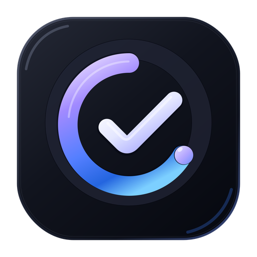

<p align="center">
  
</p>

<h1 align="center">Locksy</h1>

<p align="center">
  A focused Android task manager that keeps everyday priorities visible on your lock screen.
</p>

<p align="center">
  
  
  
</p>

## Overview

Locksy combines task management, reminders, and customizable lock-screen wallpapers in one Android app. Organize tasks in the app, choose how they appear on your wallpaper, and keep priorities visible without opening a separate planner.

## Features

- **Task management:** Create, edit, complete, delete, and reorder tasks. Use task colors to distinguish items and keep the list organized.
- **Lock-screen wallpapers:** Turn the current task list into a wallpaper and choose a layout that works with the Android system clock.
- **Background customization:** Choose built-in backgrounds or personal images, and configure slideshow backgrounds where available.
- **Reminders:** Schedule reminders for tasks that need attention later.
- **Automatic updates:** Apply wallpaper changes manually or enable automatic updates after task edits.
- **Personalization:** Switch between light and dark themes, adjust language settings, and customize the app to your preferences.
- **Adaptive interface:** Use settings panels and dialogs designed to fit their content and available screen space.
- **Local storage:** Keep task data on the device in the app's private storage.

> **Wallpaper note:** Android lock-screen clocks can vary by device, system version, and user customization. Locksy offers layout profiles to help keep task content readable; it does not control the system clock itself, and some devices may crop wallpapers differently.

## Technology

- .NET 10 and .NET MAUI
- Android-specific integrations for wallpaper application and reminder scheduling
- MVVM-oriented separation of UI state and application workflows
- Local JSON storage for task data, with app preferences saved on-device

## Requirements

- Android 7.0 (API 24) or later
- For building from source: Windows, the .NET 10 SDK, the .NET MAUI Android workload, and the Android SDK/platform tools
- Visual Studio with the .NET MAUI development workload is recommended

## Build from source

1. Install the .NET 10 SDK and the .NET MAUI Android workload. If using Visual Studio, select the .NET MAUI workload in Visual Studio Installer.
2. Clone the repository and open `Locksy.sln` or `Locksy.csproj`.
3. Restore the project and build for Android:

   ```powershell
   dotnet workload restore .\Locksy.csproj
   dotnet restore .\Locksy.csproj
   dotnet build .\Locksy.csproj -f net10.0-android -c Debug
   ```

4. Select an Android emulator or connected device as the deployment target and run the app from Visual Studio, or deploy the generated build using your usual Android tooling.

To prepare a release build, use the `Release` configuration and sign the package with your own release key before distributing it. Do not commit signing keys, passwords, or other signing credentials to the repository.

## Project structure

| Path | Purpose |
| --- | --- |
| `Models/` | Task and wallpaper data models |
| `ViewModels/` | Bindable UI state and app workflows |
| `Views/` | Reusable views and view code-behind |
| `Services/` | Task storage, settings, localization, reminders, and wallpaper services |
| `Platforms/Android/` | Android-specific wallpaper, alarm, notification, and lifecycle integrations |
| `Resources/` | App icon, splash screen, images, and SVG assets |
| `Commands/`, `Factories/`, `Helpers/` | Shared commands, object creation, and utility code |

## Releases and issue reports

- **Releases:** [GitHub Releases](https://github.com/Mohsen-Arshad/Locksy/releases)
- **Bug reports and feature requests:** Open a [GitHub Issue](https://github.com/Mohsen-Arshad/Locksy/issues) and include your Android version, device model, app version, and steps to reproduce the issue. Do not include personal data or signing credentials.

## License

This project is licensed under the **GNU General Public License v2.0 (GPL-2.0)**.

See the [LICENSE](LICENSE) file for the full text.
